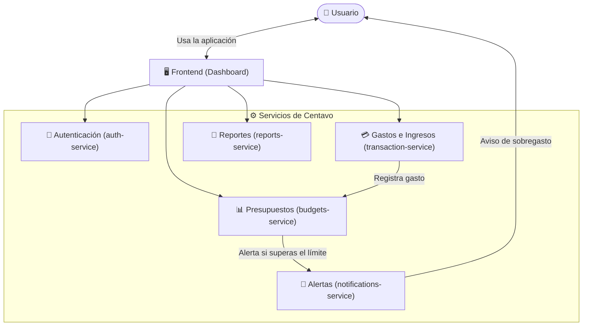

# 🪙 Centavo

**Centavo** es una aplicación de finanzas personales diseñada para uso individual. Permite llevar un control riguroso del flujo de dinero mediante el registro y categorización de gastos, la definición de presupuestos personalizados y el envío oportuno de alertas ante sobrecostos o desvíos presupuestarios.

---

## 🏛️ Arquitectura del Sistema

El proyecto está diseñado bajo un enfoque de **monorepo con microservicios desacoplados**, permitiendo que cada servicio mantenga su propio ciclo de vida, modelo de dominio y responsabilidades bien delimitadas.

### Diagrama de Arquitectura



---

## 📁 Estructura del Repositorio

```text
centavo/
├── frontend/                 # Interfaz de usuario (Dashboard y visualización)
├── auth-service/             # Servicio de autenticación y sesiones
├── transaction-service/      # Registro y categorización de transacciones
├── budgets-service/          # Definición y seguimiento de presupuestos
├── notifications-service/    # Despacho de alertas y notificaciones
├── reports-service/          # Generación de reportes automáticos
└── README.md                 # Documentación general del monorepo
```

---

## 🧩 Componentes y Responsabilidades

### 1. `frontend/` (Dashboard)
* **Propósito:** Punto de interacción visual para el usuario final.
* **Responsabilidades:**
  * Renderizar dashboards de balance general, gráficos de distribución de gastos y progreso de presupuestos.
  * Formularios intuitivos para captura ágil de transacciones y parametrización de presupuestos.
  * Gestión segura de tokens de sesión y estado en el cliente.

### 2. `auth-service/` (Autenticación)
* **Propósito:** Gestión de identidad y control de acceso seguro.
* **Responsabilidades:**
  * Registro, login y administración de credenciales de usuario.
  * Emisión, validación y rotación de tokens de acceso (JWT).
  * Hashing seguro de contraseñas y middleware de autorización.

### 3. `transaction-service/` (Registro y Categorización)
* **Propósito:** Núcleo transaccional de ingresos y egresos.
* **Responsabilidades:**
  * Operaciones CRUD para transacciones financieras.
  * Clasificación automática y manual por categorías (ej. alimentación, vivienda, servicios, ocio) y etiquetas.
  * Publicación de eventos de nuevos gastos para su conciliación presupuestaria.

### 4. `budgets-service/` (Presupuestos)
* **Propósito:** Control de límites de gasto por periodo o categoría.
* **Responsabilidades:**
  * Creación y administración de metas de gasto (semanales, mensuales, anuales).
  * Cálculo dinámico del porcentaje de ejecución presupuestaria.
  * Detección de umbrales críticos (ej. 80%, 100%, sobregasto) y emisión de eventos de alerta.

### 5. `notifications-service/` (Alertas)
* **Propósito:** Comunicación de alertas críticas y recordatorios.
* **Responsabilidades:**
  * Escuchar eventos de sobregasto emitidos por `budgets-service`.
  * Despachar avisos a través de diferentes canales (correo electrónico, notificaciones push, avisos in-app).
  * Gestión de preferencias de notificación y frecuencia de avisos.

### 6. `reports-service/` (Reportes Automáticos)
* **Propósito:** Analítica, consolidación y resúmenes periódicos.
* **Responsabilidades:**
  * Generación programada de balances consolidados (semanales, mensuales).
  * Comparativas históricas y proyecciones de ahorro o sobregasto.
  * Exportación de reportes en formatos estándar (PDF, CSV o visualización en dashboard).

---

## 🚀 Próximos Pasos Recomendados

1. **Definición de tecnologías base:**
   * Frontend: Framework moderno (ej. Next.js / React + Tailwind CSS).
   * Backend: Lenguajes/runtimes de microservicios (ej. Node.js/TypeScript, Go o Python).
   * Persistencia y mensajería: Base de datos por servicio (ej. PostgreSQL) y broker de eventos (ej. RabbitMQ o Redis).
2. **Creación de directorios y estructura inicial (Scaffolding)** para cada microservicio.
3. **Orquestación local:** Creación de un `docker-compose.yml` para levantar la infraestructura de desarrollo local.
